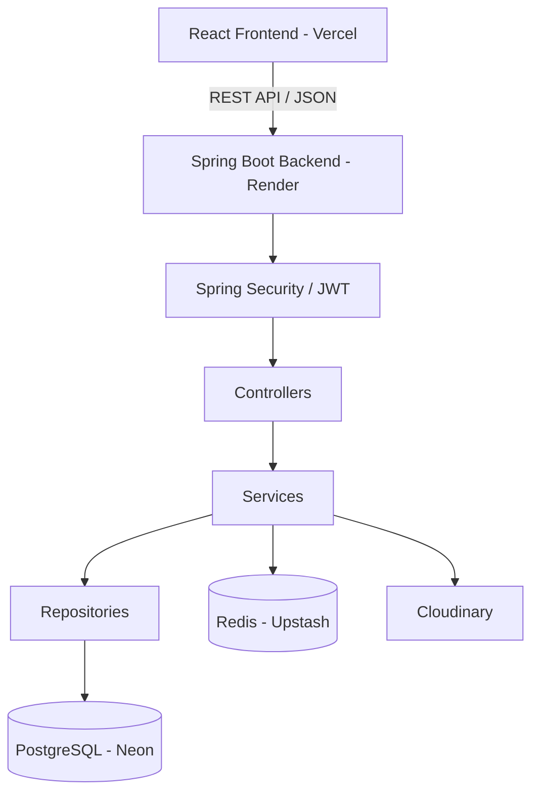

# UVMart - Full-stack E-commerce

UVMart is a full-stack e-commerce application for electronics, laptops, smartphones, and accessories, built with Java 21, Spring Boot, React, and PostgreSQL.

The application includes a customer storefront and an administration dashboard, with a focus on REST API development, inventory management, transaction consistency, concurrency control, and automated testing.

## Live Demo

- **Website:** https://uvmart-psi.vercel.app/
- **Backend API:** https://uvmart-api.onrender.com
- **Swagger UI:** https://uvmart-api.onrender.com/swagger-ui/index.html

> The backend may take longer to respond after inactivity due to Render cold starts. If the initial request times out, wait for the backend to start and reload the page.

> This is an educational portfolio project. It does not process real payments.

## Tech Stack

| Layer | Technologies |
|---|---|
| Backend | Java 21, Spring Boot 4, Spring Web MVC |
| Frontend | React, Vite, React Router, Axios |
| Security | Spring Security, JWT |
| Database | PostgreSQL, Spring Data JPA, Hibernate |
| Caching | Redis, Spring Cache |
| Image Storage | Cloudinary |
| API Documentation | Swagger UI, OpenAPI |
| Testing | JUnit 5, Mockito, Spring Boot Test |
| Build Tools | Maven, npm |
| DevOps | Docker, Docker Compose, GitHub Actions |
| Cloud Deployment | Vercel, Render, Neon, Upstash |

## Features

### Customer Storefront

- User registration and login.
- Product browsing by category.
- Product search, filtering, sorting, and pagination.
- Product details and technical specifications.
- Product variant selection by color and storage capacity.
- Variant-specific pricing, images, and inventory.
- Shopping cart management.
- Order checkout and order history.
- Order status tracking.
- Pending order cancellation.
- Responsive desktop and mobile layouts.

### Administration Dashboard

- Dashboard with revenue, order, product, and inventory statistics.
- Revenue charts and recent orders.
- Category management.
- Product management.
- Product variant and SKU management.
- Inventory and low-stock monitoring.
- Attribute group and attribute management.
- Category-specific attribute configuration.
- Product technical specification management.
- Product and variant image uploads using Cloudinary.
- Order search, filtering, pagination, and detail views.
- Order status management.

### Authentication and Authorization

- JWT-based authentication.
- Password hashing with BCrypt.
- Environment-based CORS configuration.
- Stateless authentication with Spring Security.
- Role-based access control for ADMIN and USER.
- Protected backend endpoints.
- Protected frontend administration routes.
- Authentication state persistence.
- Automatic session cleanup when the JWT expires.
- Centralized API exception handling.
- Request validation.

### Product and Inventory Management

- Product and category CRUD operations.
- Product variants with unique SKUs.
- Variant-specific stock quantities and prices.
- Dynamic product specifications based on categories.
- Product price ranges and aggregated variant availability.
- Product sorting based on effective selling prices.
- Prevention of product and variant deletion when referenced by existing cart or order items.

### Shopping Cart and Order Processing

- Shopping cart support for standard products and product variants.
- Cart quantity validation.
- Stock availability validation during checkout.
- Server-side order total calculation.
- Order item price snapshots.
- Automatic inventory deduction after successful checkout.
- Automatic inventory restoration when pending orders are cancelled.
- Controlled order status transitions.

Order lifecycle:

```text
PENDING -> CONFIRMED -> SHIPPED -> DELIVERED
    |
    +----> CANCELLED
```

### Transaction Management and Concurrency Control

- Transactional checkout and cancellation using `@Transactional`.
- Pessimistic locking for inventory updates.
- Consistent lock ordering to reduce deadlock risks.
- Prevention of concurrent overselling.
- Protection against duplicate checkout requests for the same cart.
- Protection against repeated inventory restoration during concurrent cancellation.
- Transaction rollback when an operation fails.

### Redis Caching

- Redis caching for product detail retrieval.
- Cache expiration with a 10-minute TTL.
- Cache eviction when products are updated or deleted.
- Cache invalidation after successful checkout and order cancellation.
- Transaction-aware cache invalidation for checkout, cancellation, and product deletion.
- Reduced repeated database queries for cached product details.

### Image Management

- Cloudinary integration for product and variant images.
- Image upload through protected administration endpoints.
- File type and file size validation.
- Variant-specific image display on product detail pages.

### API Documentation

- Interactive API documentation with Swagger UI.
- OpenAPI specification.
- JWT Bearer authentication support in Swagger UI.

## System Architecture

The application follows a layered architecture with a separate React frontend and Spring Boot backend.



### Backend Layers

- **Controller:** Handles HTTP requests and responses.
- **Service:** Implements business logic, validation, and transaction management.
- **Repository:** Handles database access using Spring Data JPA.
- **Entity:** Represents persistent domain objects.
- **DTO:** Defines API request and response structures.
- **Security:** Handles authentication and authorization.
- **Exception:** Provides centralized exception handling.

### Frontend

- React components and reusable UI elements.
- React Router for client-side navigation.
- Axios for REST API communication.
- Context API for authentication and shopping cart state.
- Separate customer and administration layouts.
- Responsive CSS layouts.

## Main Domain Entities

- User
- Category
- Product
- ProductVariant
- AttributeGroup
- Attribute
- ProductAttributeValue
- Cart
- CartItem
- Order
- OrderItem

## API Overview

The backend provides REST API endpoints for:

| Module | Description |
|---|---|
| Authentication | User login and JWT authentication |
| Users | User registration |
| Categories | Product category management |
| Products | Product browsing and management |
| Product Variants | SKU, price, and inventory management |
| Attributes | Product attribute configuration |
| Shopping Cart | Cart item management |
| Orders | Checkout, order history, and cancellation |
| Administration | Dashboard statistics and order management |
| Image Upload | Cloudinary image uploads |

Protected endpoints require a valid JWT. Administration endpoints require the ADMIN role.

## Testing

The backend test suite includes unit tests and integration tests covering business logic, checkout, inventory management, concurrency, and transaction rollback.

**Previously recorded local test result: 21 tests passed, 0 failures.**

### Production Smoke Testing

The deployed application has been manually tested for administrator access, product variant management, shopping cart and checkout, order processing through delivery, and pending order cancellation with inventory restoration. These manual checks complement the automated backend tests.

### Integration Test Scenarios

| Test Class | Purpose |
|---|---|
| OrderCheckoutIntegrationTest | Verifies order creation, price snapshots, inventory updates, and cart cleanup |
| OrderConcurrencyTest | Verifies concurrent checkout protection for standard products and product variants |
| OrderCancelConcurrencyTest | Verifies that concurrent cancellation does not restore inventory multiple times |
| OrderRollbackIntegrationTest | Verifies that insufficient stock prevents checkout without changing existing data |
| TransactionRollbackIntegrationTest | Verifies transaction rollback after database writes and a runtime exception |
| ProductServiceImplTest | Verifies product service business logic and safe product deletion |

The transaction rollback test uses `TransactionTemplate` to verify rollback behavior independently of the checkout service.

### Run Tests

Windows PowerShell:

```powershell
.\mvnw.cmd test
```

macOS/Linux:

```bash
./mvnw test
```

Run individual test classes:

```powershell
.\mvnw.cmd "-Dtest=OrderCheckoutIntegrationTest" test
.\mvnw.cmd "-Dtest=OrderConcurrencyTest" test
.\mvnw.cmd "-Dtest=OrderCancelConcurrencyTest" test
.\mvnw.cmd "-Dtest=OrderRollbackIntegrationTest" test
.\mvnw.cmd "-Dtest=TransactionRollbackIntegrationTest" test
.\mvnw.cmd "-Dtest=ProductServiceImplTest" test
```

Configure the dedicated test database and required services before running integration tests.

## Continuous Integration

The project includes a GitHub Actions workflow for:

- Automated builds on pushes and pull requests to `main`.
- Automated test execution using Java 21.
- PostgreSQL and Redis services for integration testing.
- Docker image build verification.

## Cloud Deployment

| Component | Platform |
|---|---|
| React frontend | Vercel |
| Spring Boot backend | Render (Docker) |
| PostgreSQL database | Neon |
| Redis cache | Upstash (TLS) |
| Product image storage | Cloudinary |
| Continuous integration | GitHub Actions |

The frontend communicates with the backend over HTTPS. Production configuration is managed using environment variables, including the API base URL, allowed CORS origins, database credentials, Redis credentials, JWT secret, and Cloudinary credentials.

## Getting Started

### Prerequisites

- Java 21
- Node.js and npm
- PostgreSQL
- Redis
- Docker Desktop (optional)
- Cloudinary account for image uploads

### 1. Clone the Repository

```bash
git clone https://github.com/Brian2502/ecommerce-spring-boot.git
cd ecommerce-spring-boot
```

### 2. Configure Environment Variables

Windows PowerShell:

```powershell
Copy-Item .env.example .env
```

macOS/Linux:

```bash
cp .env.example .env
```

Configure the environment variables defined in `.env.example` and the application configuration.

The backend requires configuration for:

- PostgreSQL connection.
- Database credentials.
- JWT secret and expiration.
- Redis connection.
- Cloudinary credentials.
- Allowed frontend origins (`APP_CORS_ALLOWED_ORIGINS`).

Never commit real passwords, JWT secrets, API keys, or other credentials.

### 3. Run the Backend

Start PostgreSQL and Redis before running the Spring Boot application.

Windows PowerShell:

```powershell
.\mvnw.cmd spring-boot:run
```

macOS/Linux:

```bash
./mvnw spring-boot:run
```

The backend runs at:

http://localhost:8081

### 4. Run the Frontend

Open a separate terminal:

```bash
cd frontend
npm install
npm run dev
```

The frontend uses `VITE_API_URL` when configured, otherwise it uses the relative `/api` path with the local Vite proxy.

For production, set the following variable in Vercel and rebuild the frontend:

```env
VITE_API_URL=https://uvmart-api.onrender.com/api
```

On Render, configure the allowed frontend origin:

```env
APP_CORS_ALLOWED_ORIGINS=https://uvmart-psi.vercel.app
```

For local development, the default allowed origin is `http://localhost:5173`.

The default Vite development URL is:

http://localhost:5173

### 5. Build the Frontend

```bash
cd frontend
npm run build
```

The production build is generated in the `frontend/dist` directory.

## Run Backend with Docker Compose

Configure the required environment variables before starting the containers.

```bash
docker compose up -d --build
```

Check container status:

```bash
docker compose ps
```

View backend logs:

```bash
docker compose logs -f app
```

Stop containers:

```bash
docker compose down
```

The Docker Compose configuration must provide access to PostgreSQL and Redis.

Avoid using `docker compose down -v` unless you intentionally want to remove stored database data.

## API Documentation

Once the backend is running:

- Swagger UI: http://localhost:8081/swagger-ui/index.html
- OpenAPI Specification: http://localhost:8081/v3/api-docs
- Production Swagger UI: https://uvmart-api.onrender.com/swagger-ui/index.html
- Production OpenAPI: https://uvmart-api.onrender.com/v3/api-docs

To test protected endpoints, log in to obtain a JWT and use the Authorize button in Swagger UI.

## Future Improvements

- Improved loading and retry experience during backend cold starts.
- Online payment integration.
- Email notifications.
- Asynchronous order processing with RabbitMQ.
- Application monitoring and structured logging.
- Expanded frontend and end-to-end testing.

## Author

**Ha Hoang Uy Vu**

GitHub: https://github.com/Brian2502
